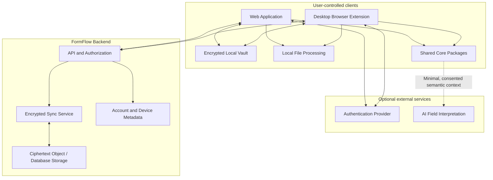

# FormFlow — System Architecture Document (SAD)

**Version:** 1.0  
**Status:** Proposed architecture baseline  
**Product:** FormFlow  
**Architecture style:** Local-first, modular, privacy-focused  
**Initial delivery:** Web application → Desktop browser extension → Mobile integrations  
**Primary users:** University admission applicants, job seekers, and people completing repetitive applications

---

# 1. Executive Summary

## 1.1 Purpose

This document defines the technical architecture for FormFlow, including:

- Web application.
- Desktop browser extension.
- Shared application logic.
- Client-side encrypted vault.
- Encrypted synchronization and recovery.
- AI-assisted form understanding.
- Local document and image processing.
- Application history.
- Security boundaries and data flows.
- Deployment, testing, and future mobile integration.

The architecture prioritizes minimizing personal data exposure while providing a practical, maintainable implementation.

## 1.2 Architectural principles

1. **Local-first personal data:** Profile values, documents, and application history are stored in an encrypted vault controlled by the user.
2. **Encryption before synchronization:** Vault content is encrypted on the authorized device before it reaches cloud storage.
3. **Least-privilege access:** The extension accesses only the webpage and data needed for the current operation.
4. **AI is optional:** Deterministic field detection and matching should work without AI wherever possible.
5. **Local file processing:** Routine image and PDF operations should not require a backend or AI service.
6. **Explicit user control:** Users review uncertain matches, sensitive fields, and completed applications.
7. **Separate account and vault security:** Authentication proves account access; vault keys control access to encrypted personal data.
8. **Shared domain logic:** The web app, extension, and future mobile clients reuse the same field taxonomy, data contracts, validation rules, and security policies.
9. **No silent data invention:** Missing personal values remain missing until the user supplies them.
10. **Observable without exposing data:** Operational telemetry must not contain plaintext profile values or document contents.

## 1.3 High-level architecture



**Important distinction:** The diagram represents logical components. The web app and extension do not automatically share the same browser storage or JavaScript runtime. Each client needs its own authorized local vault instance, with a deliberate encrypted synchronization and key-access design.

---

# 2. System Context and Trust Boundaries

FormFlow consists of six primary subsystems.

| Subsystem | Main responsibility | Trust boundary |
|---|---|---|
| Web application | Onboarding, profile management, assets, file preparation, application history | User's browser and application origin |
| Browser extension | Inspect supported form controls and fill approved values | Browser extension permissions and website DOM |
| Local vault | Encrypt and decrypt personal information | User-controlled device and unlocked application session |
| Sync backend | Store and transfer encrypted vault data | Backend is not trusted with plaintext vault content |
| AI adapter | Interpret ambiguous field semantics | External provider boundary, if cloud AI is used |
| File-processing engine | Convert, resize, compress, and validate files | Local processing environment and imported file boundary |

## 2.1 Trusted components

Components may be trusted only for their defined responsibility:

- The vault cryptographic module handles encryption and key access.
- The extension's fill controller writes approved values to supported page controls.
- The sync service authorizes devices and transports ciphertext.
- The file-processing engine transforms imported data according to explicit constraints.
- The AI adapter filters and minimizes any permitted external request.

No component should receive unrestricted access to all user data merely because it is part of FormFlow.

## 2.2 Untrusted inputs

The architecture must treat the following as untrusted:

- Webpage labels, instructions, and field values.
- Website scripts and dynamically generated form controls.
- Imported files and document metadata.
- AI-generated classifications and suggested mappings.
- Browser messages and extension-to-page communication.
- Synchronization payloads received from storage.
- User-provided URLs and filenames.

All untrusted input must be validated before it influences a security-sensitive action.

---

# 3. Web Application Architecture

## 3.1 Responsibilities

The web application provides the primary user-facing experience.

It is responsible for:

- Registration and sign-in.
- Vault initialization and unlocking.
- Onboarding.
- Universal profile management.
- Education and employment records.
- Purpose-based profile configuration.
- Asset and document management.
- Smart File Preparation.
- My Applications.
- Device management and synchronization status.
- Recovery guidance.
- Export and deletion workflows.

The web app is not responsible for directly controlling every third-party application form. That responsibility belongs to the extension.

## 3.2 Logical layers

```text
Web Application
├── Presentation Layer
│   ├── Screens and navigation
│   ├── Forms and validation feedback
│   └── Accessible responsive UI
│
├── Application Layer
│   ├── Onboarding workflows
│   ├── Profile commands
│   ├── Asset management
│   ├── Application-history commands
│   └── Vault and sync orchestration
│
├── Domain Layer
│   ├── Profile models
│   ├── Education and employment models
│   ├── Asset metadata
│   ├── Application status rules
│   └── Field taxonomy and validation
│
├── Security Layer
│   ├── Vault unlock and lock
│   ├── Encryption/decryption
│   ├── Key lifecycle management
│   └── Session memory cleanup
│
└── Infrastructure Layer
    ├── IndexedDB or equivalent local persistence
    ├── Sync API client
    ├── Authentication integration
    └── Local file-processing workers
```

## 3.3 Storage responsibilities

The web application should distinguish between:

**Local encrypted storage**

- Profile data.
- Education and employment records.
- Asset metadata and locally retained files.
- Application history.
- User preferences that contain private information.
- Encrypted local change journal.

**Backend storage**

- Account identity and authentication references.
- Device registration and revocation metadata.
- Encrypted vault snapshots or encrypted change records.
- Ciphertext versioning and synchronization metadata.
- Minimum operational information required for service operation.

The backend must not receive plaintext profile fields, application history, or document contents under the intended zero-knowledge design.

Authentication metadata such as verified email or phone may remain visible to the authentication provider and should not be represented as zero-knowledge data.

## 3.4 Web application behavior

The web app should support offline access to previously synchronized information after the vault has been unlocked, subject to the configured session and device security policy.

Changes should be written to the local encrypted store first. Synchronization can happen afterward.

If synchronization fails:

- The local change remains available.
- The interface shows pending synchronization.
- The user can retry.
- The app must not claim that the latest changes are backed up.

---

# 4. Desktop Browser Extension Architecture

## 4.1 Responsibilities

The extension is responsible for interacting with the current application form.

It should:

1. Detect accessible form controls.
2. Extract field labels and relevant structural information.
3. Classify control types.
4. Identify candidate semantic types.
5. Request relevant values from the authorized vault.
6. Match fields to saved records.
7. Apply confidence and sensitivity rules.
8. Fill approved fields.
9. Verify results where possible.
10. Prepare or attach supported files.
11. Offer to create an application-history record.

The extension must not automatically submit an application.

## 4.2 Logical architecture

```text
Browser Extension
├── Extension UI
│   ├── Connect and unlock
│   ├── Detection status
│   ├── Field-match review
│   ├── Fill results
│   └── Application-record prompt
│
├── Background / Service Worker
│   ├── Extension lifecycle
│   ├── Permission checks
│   ├── Vault and sync coordination
│   └── Message routing
│
├── Content Script
│   ├── DOM inspection
│   ├── Field extraction
│   ├── Page-change observation
│   └── Approved fill execution
│
├── Form Intelligence
│   ├── Control classification
│   ├── Semantic mapping
│   ├── Confidence evaluation
│   └── Sensitivity policy
│
├── Fill Controller
│   ├── Control-specific interaction
│   ├── Result verification
│   └── Failure reporting
│
└── Local Vault Adapter
    ├── Authorized field retrieval
    └── Encrypted local persistence
```

## 4.3 Browser security model

The extension must use the browser's supported extension architecture, including isolated content scripts, restricted permissions, and explicit messaging.

Requirements:

- Request the minimum permissions necessary.
- Avoid unrestricted access to all websites unless justified and clearly disclosed.
- Do not expose vault plaintext to page JavaScript.
- Do not insert private profile values into page-global variables.
- Do not accept arbitrary page messages as authorization to retrieve vault data.
- Validate messages between the extension UI, background context, and content scripts.
- Treat webpage instructions as data, not executable instructions.
- Never allow page content to override security policy or request unrestricted vault access.

A webpage may be malicious even if the user intentionally opened it.

## 4.4 Form detection pipeline

```text
Current webpage
    ↓
Accessible DOM extraction
    ↓
Control type classification
    ↓
Label and instruction extraction
    ↓
Semantic mapping
    ↓
Confidence and sensitivity evaluation
    ↓
Candidate value retrieval from vault
    ↓
User review where required
    ↓
Approved fill operation
    ↓
Result verification
```

### Control type

Examples:

- Text input.
- Email input.
- Telephone input.
- Date input.
- Select.
- Radio group.
- Checkbox.
- File input.
- Contenteditable element.
- Custom or unsupported control.

### Semantic type

Examples:

- First name.
- Last name.
- Email.
- Phone number.
- Date of birth.
- Father's name.
- Present address.
- Permanent address.
- University.
- Degree.
- GPA.
- Employer.
- Job title.
- CV.
- Profile photo.
- Signature.
- Consent declaration.

Control type and semantic type must remain separate. An email field is a control type, while a candidate email address field is a semantic interpretation.

## 4.5 Fill policy

The fill controller should apply policy before executing any field operation.

| Field classification | Behavior |
|---|---|
| High-confidence ordinary field | Fill according to user settings |
| Ambiguous field | Ask for confirmation or leave blank |
| Conflicting values | Show candidate values and request a choice |
| Sensitive field | Require additional review where appropriate |
| Legal declaration or consent | Require explicit user action |
| Password, OTP, CAPTCHA | Keep user-controlled |
| Unsupported custom control | Offer a guided fallback |

The extension must verify the resulting value where technically possible. Some frameworks and custom widgets require specific events or state updates, so assigning a DOM value alone is not a sufficient success condition.

## 4.6 Dynamic pages

The extension should handle changing pages by:

- Observing relevant DOM changes.
- Re-detecting newly inserted fields.
- Avoiding unnecessary repeated scans.
- Invalidating stale field references.
- Detecting when a page has navigated or changed application state.
- Asking for renewed review if a previously approved mapping becomes invalid.

Closed shadow DOM, some cross-origin frames, canvas-rendered forms, and certain custom uploaders may remain unsupported.

---

# 5. Shared Core Packages

The web app and extension should share domain logic without sharing privileged browser-specific code.

Recommended conceptual packages:

```text
packages/
├── domain/
│   ├── profile-models
│   ├── education-models
│   ├── employment-models
│   ├── asset-models
│   └── application-models
│
├── field-taxonomy/
│   ├── control-types
│   ├── semantic-types
│   ├── label-dictionaries
│   └── mapping-rules
│
├── validation/
│   ├── profile-validation
│   ├── field-validation
│   └── file-constraints
│
├── form-intelligence/
│   ├── deterministic-matcher
│   ├── confidence-policy
│   └── ai-request-contracts
│
├── vault-core/
│   ├── encryption-interface
│   ├── key-management-interface
│   ├── encrypted-record-format
│   └── vault-repository-interface
│
├── sync-contracts/
│   ├── encrypted-record-envelope
│   ├── versioning
│   └── conflict-contracts
│
└── file-processing/
    ├── image-operations
    ├── pdf-operations
    └── output-validation
```

This is a logical package structure, not a requirement to create a separate repository for every package.

## 5.1 Shared-code boundaries

Shared packages must not import:

- DOM APIs into the web app's domain models.
- Browser extension APIs into generic field-matching rules.
- Server credentials into client bundles.
- Cloud AI provider SDKs into the vault cryptographic core.
- UI frameworks into domain entities.

Browser-specific integrations should implement narrow interfaces defined by the shared core.

---

# 6. Local Vault Architecture

## 6.1 Purpose

The vault protects reusable personal information and documents.

It should hold:

- Universal profile information.
- Education and employment records.
- Skills and application-purpose settings.
- Document metadata and file contents.
- Application history and notes.
- Private field provenance and verification metadata.
- User preferences requiring confidentiality.

## 6.2 Local persistence

Use an appropriate browser-local persistence mechanism, such as IndexedDB for the web application and extension-supported local storage for the extension, with a database layer suitable for encrypted records.

The exact storage technology can differ by client. The encryption and record-format contract should remain compatible.

**Do not assume that the web app and extension share storage.** Browser origins and extension storage contexts are distinct. Each must have its own controlled access path to the vault.

## 6.3 Encryption model

Use a reviewed envelope-encryption design with vetted cryptographic libraries.

A conceptual model:

```text
User's vault data
       ↓
Serialize and validate records
       ↓
Generate or use a versioned data-encryption key (DEK)
       ↓
Encrypt records using authenticated encryption
       ↓
Store encrypted records locally
       ↓
Synchronize ciphertext when enabled
```

The data-encryption key must itself be protected by an appropriate key-encryption mechanism. A user's password should not be used directly as an encryption key.

A possible design is:

- A random vault data-encryption key encrypts vault records.
- A key derived from a vault passphrase wraps the data-encryption key.
- A separate recovery secret can wrap the same data-encryption key.
- Authorized devices receive or derive access through the defined enrollment and recovery protocol.

The final key hierarchy must be specified and reviewed before implementation.

## 6.4 Key derivation and cryptography

Requirements:

- Use authenticated encryption from a maintained cryptographic library.
- Use a password-based key derivation function with a reviewed configuration.
- Generate random secrets using a cryptographically secure random source.
- Include a unique nonce or IV according to the chosen encryption algorithm's requirements.
- Authenticate ciphertext and relevant record metadata.
- Version encryption formats and key derivation parameters.
- Support a carefully planned key-rotation and migration strategy.
- Never implement a custom encryption algorithm.

If Argon2id is selected, verify browser compatibility, implementation quality, and memory requirements. Where a suitable implementation is not available, select a vetted alternative based on an explicit security review.

## 6.5 Vault locking

When the vault is locked:

- Private values are no longer available to ordinary UI components.
- Extension filling is disabled.
- Pending actions cannot read private values.
- Session-held key material is cleared as far as the runtime permits.
- Local encrypted records remain stored.
- Unlocking requires the configured authentication or key-unwrapping process.

Memory clearing in managed runtimes is best-effort; the architecture must not promise that every plaintext memory copy can always be securely erased.

## 6.6 Record format

Every encrypted record should include sufficient metadata to support versioning and synchronization.

Example logical envelope:

```json
{
  "record_id": "opaque-record-id",
  "record_type": "profile",
  "schema_version": 1,
  "encryption_version": 1,
  "nonce": "encoded-nonce",
  "ciphertext": "encoded-ciphertext",
  "authentication_tag": "encoded-tag"
}
```

This is illustrative, not a final wire format. The implementation should follow the selected cryptographic library's actual API and serialization requirements. Do not add redundant cryptographic fields if the chosen API already packages them.

The backend should receive only the fields necessary for storage and synchronization. Private record types and metadata should be encrypted where practical.

---

# 7. Cross-Device Synchronization Architecture

## 7.1 Goal

Allow users to use the same profile on authorized devices without requiring the backend to decrypt their personal information.

Synchronization should be opt-in or clearly disclosed, encrypted before upload, and resilient to interrupted connections.

## 7.2 Synchronization flow

```text
Authorized device
       ↓
Modify local vault record
       ↓
Validate and encrypt locally
       ↓
Write encrypted record to local persistence
       ↓
Add change to local sync queue
       ↓
Authenticate and authorize device
       ↓
Upload ciphertext and version metadata
       ↓
Backend validates access and stores ciphertext
       ↓
Another authorized device downloads ciphertext
       ↓
Verify envelope and decrypt locally
       ↓
Apply version/conflict policy
       ↓
Update local vault
```

## 7.3 Backend responsibilities

The backend may:

- Authenticate the account or validate its session.
- Verify that the device is authorized to synchronize.
- Store encrypted snapshots or encrypted change records.
- Maintain ciphertext versions and synchronization cursors.
- Detect duplicate operations.
- Enforce quotas and rate limits.
- Report synchronization state.

The backend must not:

- Decrypt vault records.
- Store plaintext recovery secrets.
- Silently rewrite encrypted records.
- Claim that a device has synchronized changes that it has not acknowledged.
- Use vault plaintext for analytics.

## 7.4 Conflict resolution

Two devices may edit the same record while offline.

The initial synchronization implementation should use explicit version metadata and detect concurrent updates. It should not silently overwrite one version with another.

Recommended initial policy:

1. Every record has an opaque identifier and version.
2. A local edit records the previous version and creates a new encrypted version.
3. The server detects stale-version updates.
4. Concurrent changes are returned to the client as a conflict.
5. The client applies a type-aware merge where safe.
6. Otherwise, the user chooses which version to keep or creates a merged record.

Do not rely on timestamps alone to establish a universally correct ordering.

## 7.5 Snapshot and change-log strategy

For the first implementation, choose one primary synchronization strategy rather than combining several prematurely.

A practical starting point is:

- Encrypted record-level updates.
- Versioned encrypted snapshots for recovery and efficient restoration.
- A sync cursor or sequence for downloading changes.
- Idempotent upload operations.
- Periodic integrity and restoration tests.

The server may learn operational metadata such as upload sizes, timestamps, account identifiers, and access patterns unless additional privacy measures are implemented. The zero-knowledge claim must explicitly describe these remaining metadata exposures.

## 7.6 Device enrollment

A newly authorized device must obtain the ability to decrypt the vault through the defined cryptographic protocol.

Potential mechanisms include:

- Unlocking using the user's vault credential.
- Using recovery material to restore key access.
- An explicit device-pairing flow that transfers a protected key envelope.

The final choice must prevent ordinary account recovery through email or SMS from silently bypassing vault encryption.

## 7.7 Device revocation

Revocation should:

- Mark the device as unauthorized for future sync operations.
- Reject subsequent synchronization requests from the revoked device.
- Update device and authorization metadata.
- Notify other devices where appropriate.
- Document that previously downloaded plaintext or keys cannot be remotely erased with certainty.

---

# 8. AI Architecture and Boundaries

## 8.1 Purpose of AI

AI is used to interpret ambiguous webpage field semantics—not as the primary storage system, not as the source of personal facts, and not as the default engine for file conversion.

Examples of appropriate tasks:

- Interpret an unfamiliar field label.
- Understand a field instruction written in natural language.
- Suggest a candidate semantic type.
- Identify likely file requirements from visible instructions.
- Explain an uncertain mapping to the user.

## 8.2 Processing pipeline

```text
Page DOM
   ↓
Deterministic extraction
   ↓
Known labels and heuristics
   ↓
Confidence evaluation
   ├── High confidence → Apply configured deterministic policy
   ├── Medium confidence → Ask user or invoke permitted AI
   └── Low confidence → Leave unmapped
                         ↓
                  AI adapter, if enabled
                         ↓
                  Validate structured result
                         ↓
                  Apply confidence and sensitivity policy
                         ↓
                  User review when required
```

## 8.3 AI request contract

A request should include only the information required to interpret the field.

Potentially permitted:

- Generic field label.
- Control type.
- Non-sensitive visible instructions.
- Relevant option labels.
- A minimal, sanitized structural context.

Avoid transmitting by default:

- Saved profile values.
- Names, email addresses, phone numbers, or addresses.
- Complete form contents.
- Uploaded documents.
- Authentication tokens.
- Passwords, OTPs, and security challenges.
- Unnecessary page URLs or surrounding personal information.

Page labels and option text can themselves contain personal information. The AI adapter must inspect and minimize them before sending a request.

## 8.4 AI response contract

AI should return a constrained structure, such as:

```json
{
  "candidate_type": "DATE_OF_BIRTH",
  "confidence": 0.92,
  "reason_code": "LABEL_AND_CONTEXT_MATCH",
  "requires_user_review": false
}
```

This is an illustrative contract. It must be validated against a strict schema before use.

AI output is untrusted. It must never directly:

- Execute JavaScript.
- Change extension permissions.
- Retrieve arbitrary vault records.
- Submit forms.
- Approve legal declarations.
- Override field sensitivity policies.
- Bypass validation or confidence thresholds.

## 8.5 AI provider boundary

If cloud AI is used:

- The adapter is the only component permitted to invoke the provider.
- Provider credentials remain on the server or in a protected service environment, never in extension source code.
- The provider must be reviewed for retention, training use, logging, and data-processing terms.
- Requests should be minimized and subject to applicable consent and configuration.
- Provider failures must fall back to deterministic matching or user review.
- AI must not be required for basic profile management or local file conversion.

If the backend proxies AI requests, the backend becomes a processor of that request content. It must not be described as receiving no user data unless the actual request path supports that claim.

## 8.6 AI evaluation

Maintain a representative test set of field labels and instructions.

Measure:

- Classification accuracy.
- Precision and recall by semantic field type.
- False-positive fill proposals.
- Uncertainty calibration.
- Sensitive-field classification errors.
- Provider latency and failure rates.

A high average score must not conceal dangerous errors in legal, identity, or sensitive fields.

---

# 9. File-Processing Architecture

## 9.1 Principle

File preparation should be a deterministic, local operation wherever practical. AI may interpret instructions, but deterministic code must perform the actual conversion, resizing, compression, and validation.

## 9.2 Processing pipeline

```text
Select original asset
       ↓
Validate file type, size, and structure
       ↓
Read explicit or detected requirements
       ↓
Build transformation plan
       ↓
Preview or confirm transformation
       ↓
Process locally
       ↓
Validate output
       ↓
Save a separate prepared variant
       ↓
Keep original unchanged
```

## 9.3 Supported operations

### Images

- JPEG/JPG and PNG import.
- Format conversion where appropriate.
- Orientation correction.
- Resizing and cropping.
- Aspect-ratio preservation.
- Compression.
- Dimension and file-size validation.

### PDF

- Convert supported images to PDF.
- Combine multiple images into a PDF.
- Preserve selected image order.
- Optimize copies of existing PDFs where supported.
- Validate output structure and page count where applicable.

### Signatures

- Preserve original strokes and proportions.
- Allow conservative whitespace trimming where appropriate.
- Avoid stretching or reshaping.
- Preserve the original signature.
- Require review when cropping may remove meaningful content.

## 9.4 Requirement detection

Potential requirement sources:

- File input `accept` attribute.
- Whether multiple files are allowed.
- Visible instructions.
- Maximum-size messages.
- Dimension and aspect-ratio instructions.
- Validation errors after a user-selected file.
- User-provided requirements.

These sources have different reliability levels. The `accept` attribute is a hint, not proof of the server's actual validation rules.

FormFlow must not invent exact dimensions or file-size limits when they cannot be established.

## 9.5 Technology boundaries

A reasonable TypeScript implementation may use:

- Browser Canvas APIs for image manipulation.
- OffscreenCanvas or workers for suitable background processing.
- A reviewed PDF library, such as `pdf-lib`, for supported PDF creation and manipulation.
- A PDF rendering or inspection library where necessary.
- A dedicated processing adapter that can be tested independently.

Dependency selection must consider maintenance, security, licensing, file-size limits, and browser compatibility.

## 9.6 File security

- Treat imported files as untrusted.
- Validate actual content rather than trusting filenames alone.
- Apply file-size and resource limits.
- Avoid loading unbounded files into memory.
- Use temporary storage only as necessary.
- Remove temporary processing copies after the operation.
- Preserve originals on failure.
- Do not send documents to AI by default.
- Explain when a file cannot be inspected or validated safely.

## 9.7 Extension attachment boundary

Preparing a file and attaching it to a webpage are separate operations.

The file-processing engine creates a prepared file. The extension fill controller may then attach it to a supported file input if the browser and site permit it.

The extension must verify attachment when possible. For unsupported custom uploaders, the user should complete the upload manually.

---

# 10. Application History Architecture

Application history belongs to the encrypted vault, not the backend's general-purpose account database.

## 10.1 Stored information

- Application title.
- Organization.
- Category.
- Website URL.
- Start date.
- Confirmed submission date.
- Current status.
- Notes.
- Timeline events.
- Relevant asset references, where useful.

## 10.2 Status rules

Supported statuses:

- Draft.
- Ready to Submit.
- Submission Unconfirmed.
- Submitted.
- Under Review.
- Accepted.
- Rejected.
- Withdrawn.

The extension may suggest creating a record after detecting an application form, but it must not assume the user submitted it.

Application records should not contain complete form payloads by default. Application-specific answers that are sensitive or context-dependent should not be copied into the universal profile without explicit approval.

---

# 11. Backend Architecture

## 11.1 Logical services

The initial implementation can use a modular backend rather than multiple microservices.

Recommended modules:

```text
Backend
├── Authentication Integration
├── Account and Device Management
├── Authorization and Rate Limiting
├── Encrypted Sync API
├── Ciphertext Persistence
├── AI Request Adapter (optional)
├── Operational Monitoring
└── Account Deletion and Retention Workflows
```

## 11.2 API boundaries

The backend may expose logical endpoints such as:

| Endpoint | Purpose |
|---|---|
| `GET /v1/devices` | List authorized devices |
| `POST /v1/devices` | Enroll a device |
| `DELETE /v1/devices/{id}` | Revoke a device |
| `GET /v1/sync/changes` | Retrieve encrypted changes |
| `PUT /v1/sync/records/{id}` | Upload an encrypted record or version |
| `POST /v1/sync/snapshots` | Upload an encrypted snapshot |
| `GET /v1/sync/status` | Retrieve synchronization status |
| `DELETE /v1/account` | Initiate account deletion |

These are proposed contracts, not finalized endpoint specifications. Exact methods, payloads, concurrency semantics, pagination, and authentication requirements must be defined before implementation.

## 11.3 Authorization requirements

- Every request must be authenticated where required.
- Device-level authorization must be checked for sync operations.
- Object identifiers must not grant access by themselves.
- Requests must be scoped to the authenticated account.
- Payload sizes and request rates must be limited.
- Replay and duplicate operations must be handled safely.
- Server errors must not expose tokens, ciphertext internals, or private user information unnecessarily.

## 11.4 Operational observability

Collect only the telemetry required to operate the service.

Potential metrics:

- Request success and failure counts.
- Sync duration and retry counts.
- Ciphertext payload sizes.
- Error categories.
- Service latency.
- AI request latency and failure rate, without logging sensitive request bodies.

Never log vault passwords, recovery keys, decrypted records, raw documents, OTPs, or authentication tokens.

---

# 12. End-to-End Data Flows

## 12.1 Create and save a profile

1. The user authenticates.
2. The client initializes or unlocks the vault.
3. The user enters profile information.
4. The domain layer validates the values.
5. The vault layer encrypts the records.
6. Encrypted records are saved locally.
7. The sync queue records the pending changes.
8. When sync is enabled and available, ciphertext is uploaded.
9. The backend stores ciphertext and synchronization metadata.
10. The UI reports whether changes are local-only or synchronized.

## 12.2 Fill a third-party form

1. The user opens a supported website.
2. The extension inspects accessible DOM fields.
3. The form-intelligence engine extracts labels and control types.
4. Deterministic rules produce candidate semantic mappings.
5. AI is invoked only if needed and permitted.
6. The extension requests only relevant values from the unlocked vault.
7. The policy engine evaluates confidence and sensitivity.
8. The user reviews mappings that require confirmation.
9. The fill controller writes approved values.
10. The extension verifies resulting values where possible.
11. The user reviews the form and submits manually.

## 12.3 Prepare a document

1. The user selects an original asset.
2. The file processor validates the file.
3. Requirements are read from reliable sources or entered by the user.
4. A deterministic transformation plan is created.
5. The file is processed locally.
6. The output is validated.
7. The prepared variant is saved in the encrypted vault.
8. The extension attaches the file when supported or guides the user through manual attachment.

## 12.4 Restore the vault on another device

1. The user authenticates on the new device.
2. The device is enrolled or authorized.
3. The client retrieves encrypted records.
4. The user supplies the required vault credential, recovery material, or approved device-pairing authorization.
5. The client unwraps the vault key locally.
6. The client decrypts and validates records.
7. The client resolves any conflicts.
8. The vault becomes available on the authorized device.

Account authentication must not replace the cryptographic authorization needed to decrypt the vault.

---

# 13. Failure Handling and Recovery

| Failure | Required behavior |
|---|---|
| Vault cannot unlock | Keep private data inaccessible and explain supported recovery paths |
| Sync unavailable | Preserve local encrypted changes and show pending sync |
| Concurrent edits | Detect conflicts and prevent silent destructive overwrite |
| AI unavailable | Use deterministic rules or request user input |
| AI result invalid | Reject it and continue safely |
| Field mapping uncertain | Leave the field unfilled or request review |
| Fill rejected by website | Report failure and offer manual completion |
| File conversion fails | Preserve original asset and explain the failure |
| File attachment unsupported | Provide manual upload instructions |
| Device revoked | Block future sync and authorization |
| Browser extension restarted | Restore only authorized state; require unlocking if policy demands it |
| Account deletion incomplete | Report pending operations and applicable retention limits |

---

# 14. Security Threat Model

The architecture should explicitly account for the following threats.

## 14.1 Threats

- Backend database or object-storage compromise.
- Stolen account credentials.
- Compromised or malicious browser extension.
- Malicious webpage attempting to obtain profile data.
- Compromised user device.
- Recovery key theft or loss.
- Unauthorized device enrollment.
- Sync replay or malicious ciphertext replacement.
- Malicious imported files.
- Prompt injection through webpage content.
- Accidental logging or transmission of private data.
- Cross-site scripting in the web application.
- Supply-chain compromise of third-party dependencies.

## 14.2 Primary controls

- Client-side encryption before persistence and synchronization.
- Strict key separation and recovery controls.
- Least-privilege extension permissions.
- Strong content-script/background messaging validation.
- Output-schema validation for AI responses.
- Content Security Policy and standard web application security controls.
- Dependency review and automated vulnerability scanning.
- File validation and resource limits.
- Device revocation and session management.
- Privacy-preserving logging.
- Security testing before public release.

## 14.3 Important limitation

Client-side encryption protects stored data from a backend-only compromise when keys remain unavailable to the attacker. It does not guarantee protection if the user's device, unlocked browser session, extension, or application code is compromised.

A malicious update to client code may be capable of exposing plaintext when the vault is unlocked. This is a material risk for any web-based zero-knowledge product and should be addressed through deployment controls, code review, dependency security, and an accurate security claim.

---

# 15. Technology Recommendations

These are starting recommendations, not mandatory final choices.

| Area | Suggested direction | Reason |
|---|---|---|
| Web app | TypeScript with a modern component-based framework | Maintainable responsive UI |
| Browser extension | TypeScript with a supported browser extension architecture | DOM integration and shared logic |
| Shared logic | Monorepo packages with strict module boundaries | Reuse domain and field-matching logic |
| Local persistence | IndexedDB or equivalent encrypted-record store | Structured local data |
| Cryptography | Maintained, reviewed cryptographic libraries | Avoid custom cryptography |
| Sync backend | Modular API service with relational metadata storage and ciphertext storage | Keep account metadata separate from encrypted records |
| Image processing | Canvas and suitable worker APIs | Local transformations |
| PDF processing | Reviewed PDF creation and inspection libraries | Local PDF generation and validation |
| AI | Provider adapter with structured output and strict data minimization | Replaceable provider and bounded access |
| Testing | Unit, integration, browser automation, security and compatibility tests | Validate behavior across layers |

Do not select the final database, hosting provider, or AI vendor until the encryption, sync contract, deployment needs, and data-retention requirements are agreed upon.

---

# 16. Deployment Architecture

## 16.1 Client deployments

**Web application**

- Served over HTTPS.
- Uses a strict content security policy.
- Does not expose server credentials in client bundles.
- Runs the vault and file-processing code locally.

**Browser extension**

- Packaged and distributed through supported browser extension channels.
- Uses an explicit permission model.
- Contains no long-lived server-side credentials.
- Uses signed, reviewed releases where the distribution channel supports them.

## 16.2 Backend deployment

The backend can initially run as one deployable application with modular internal components.

Production infrastructure should provide:

- TLS.
- Authentication and authorization.
- Rate limiting.
- Encrypted storage for backend metadata.
- Ciphertext persistence.
- Backups and restore tests.
- Monitoring and alerting.
- Retention and deletion jobs.
- Secrets management.
- Deployment and dependency controls.

Server-side encryption at rest is useful as defense in depth but does not replace client-side encryption for a zero-knowledge vault.

## 16.3 Environments

Maintain separate:

- Local development.
- Test and automated integration.
- Staging.
- Production.

Use synthetic test profiles and documents in development. Do not copy real user vault data into test environments.

---

# 17. Testing Strategy

## 17.1 Vault tests

- Encryption and decryption round trips.
- Tampered ciphertext rejection.
- Wrong-password and invalid-recovery behavior.
- Key rotation and format migration.
- Lock and unlock behavior.
- Local persistence integrity.
- Recovery on a new device.

## 17.2 Synchronization tests

- Offline edits followed by synchronization.
- Duplicate upload and retry behavior.
- Interrupted transfers.
- Concurrent edits.
- Stale-version rejection.
- Device revocation.
- Snapshot restoration.
- Backend compromise simulation to verify stored records are not plaintext.

## 17.3 Extension tests

- Common native form controls.
- React, Vue, and Angular forms.
- Dynamic fields and conditional sections.
- Repeated education or employment fields.
- Conflicting candidate values.
- Invalid values and browser validation.
- Sensitive-field policies.
- Unsupported custom controls.
- File-upload success and failure.
- Malicious webpage message attempts.

## 17.4 AI tests

- Classification accuracy by field type.
- Malformed structured output.
- Prompt injection in labels and instructions.
- Requests containing accidental personal information.
- Provider timeout and failure.
- Incorrect confidence estimates.
- Sensitive-field false positives and false negatives.

## 17.5 File-processing tests

- Valid and invalid image files.
- Large files and resource exhaustion attempts.
- Orientation handling.
- Aspect-ratio preservation.
- PDF creation and ordering.
- Corrupt PDF handling.
- Compression and size constraints.
- Temporary-file cleanup.
- Original-asset preservation.

---

# 18. Mobile Expansion Strategy

The initial shared architecture should support future mobile clients without assuming that browser extension APIs are available on phones.

Mobile clients can reuse:

- Profile and record schemas.
- Field taxonomy.
- Validation logic.
- Vault record format.
- Cryptographic key hierarchy, subject to platform security review.
- Sync protocol.
- Application-history model.
- File-processing contracts.

They will need platform-specific integrations for:

- Android Autofill Service.
- iOS Safari Web Extension.
- Device-secure key storage.
- Native file pickers and sharing.
- Background synchronization.
- Platform lifecycle and biometric unlock policies.

Mobile integrations should not be started until the web vault, sync protocol, and desktop field-matching engine have passed their release acceptance tests.

---

# 19. Recommended Repository Structure

A TypeScript monorepo is a reasonable starting point.

```text
formflow/
├── apps/
│   ├── web/
│   ├── extension/
│   └── backend/
│
├── packages/
│   ├── domain/
│   ├── field-taxonomy/
│   ├── validation/
│   ├── form-intelligence/
│   ├── vault-core/
│   ├── sync-contracts/
│   ├── file-processing/
│   ├── ai-adapter/
│   └── test-fixtures/
│
├── docs/
│   ├── prd.md
│   ├── system-architecture.md
│   ├── security-threat-model.md
│   ├── vault-key-management.md
│   ├── sync-protocol.md
│   └── extension-compatibility.md
│
└── tests/
    ├── integration/
    ├── browser/
    ├── security/
    └── compatibility/
```

This structure can be adapted to the selected frameworks. Avoid creating separate services or packages without a clear ownership boundary.

---

# 20. Architectural Decisions to Finalize Before Implementation

The following are high-impact decisions and should be recorded as Architecture Decision Records (ADRs).

| Decision | Recommended starting position | Priority |
|---|---|---|
| Vault encryption | Client-side envelope encryption using vetted libraries | Critical |
| Vault recovery | Independent recovery mechanism; authentication alone cannot decrypt | Critical |
| Local storage | Encrypted records in client-specific local stores | Critical |
| Sync strategy | Versioned encrypted record updates plus recoverable snapshots | Critical |
| Extension access | Explicitly authorized extension vault adapter | Critical |
| AI usage | Deterministic-first; optional minimal semantic requests | High |
| File processing | Local deterministic processing | High |
| Application history | Encrypted vault records | High |
| Backend architecture | Modular service before considering microservices | Medium |
| Mobile support | Reuse shared contracts, implement platform-specific adapters later | Medium |

## 20.1 Mandatory security design review

Before implementing the vault, specify:

1. Exact key hierarchy and key-wrapping process.
2. Password derivation parameters and versioning.
3. Recovery-secret format and recovery procedure.
4. Device enrollment and revocation protocol.
5. Encrypted record and snapshot formats.
6. Sync conflict and rollback protection.
7. Backup, export, deletion, and key-rotation behavior.
8. The metadata visible to the backend.
9. Threats arising from compromised client code.
10. Independent review and test requirements.

These are implementation decisions, not details to improvise while writing the first screens.

---

# 21. Definition of Architectural Success

The architecture is ready for production-oriented implementation when:

- The web app and extension can use shared domain models without sharing unsafe execution contexts.
- Personal data is encrypted before cloud persistence.
- Account recovery and vault recovery are separate and correctly implemented.
- The extension can retrieve only authorized profile data and never exposes vault plaintext to webpage scripts.
- Deterministic field matching works without AI.
- AI requests are minimized and outputs are validated.
- File processing operates locally for supported operations and preserves originals.
- Synchronization handles offline edits, concurrent changes, retries, and device revocation.
- Application history remains encrypted and does not silently record unconfirmed submissions.
- Security tests validate both intended protections and known limitations.
- Future mobile clients can implement the shared contracts without changing the core domain model.

## Final architecture decision

FormFlow should be built as a **local-first, client-encrypted system with a modular web app, a separately sandboxed browser extension, a ciphertext-only synchronization backend, an optional AI interpretation adapter, and a deterministic local file-processing engine**.

The most important implementation boundary is that the backend transports and stores encrypted vault data but does not need to read the user's profile. The most important automation boundary is that the extension proposes and performs approved field operations without taking control of final application submission.

This architecture supports the immediate desktop-first plan while preserving a practical path to mobile applications later.