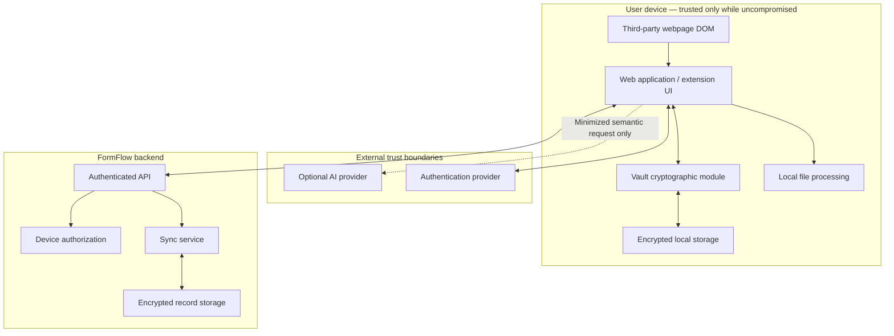
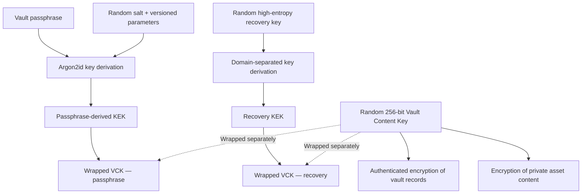

# FormFlow — Security Threat Model & Vault Key Management Specification

**Document version:** 1.0  
**Status:** Proposed security baseline — requires implementation review  
**Product:** FormFlow  
**Scope:** Web application, desktop browser extension, local vault, encrypted synchronization, AI integrations, document processing, and future mobile clients  
**Security objective:** Protect users' personal information and documents while enabling authorized reuse across supported application forms.

---

# Part A — Security Threat Model

## 1. Security objectives

FormFlow stores highly sensitive information, including names, contact details, dates of birth, family information, residential addresses, academic records, employment histories, photographs, signatures, certificates, and application histories.

The security architecture must protect this information against unauthorized access, accidental disclosure, malicious webpages, compromised backend infrastructure, and misuse of authorized devices.

### 1.1 Required security properties

| Property | Requirement |
|---|---|
| Confidentiality | Unauthorized parties must not be able to read vault contents. |
| Integrity | Unauthorized changes to encrypted records must be detected. |
| Authentication | Users must prove control of a supported account authentication method. |
| Vault authorization | Account authentication alone must not grant decryption capability. |
| Device authorization | Only authorized devices may synchronize or access the vault. |
| Data minimization | Each component receives only the information required for its task. |
| Recoverability | Users can restore access through an explicitly configured recovery mechanism. |
| Revocation | Revoked devices lose future authorization, subject to documented limitations. |
| Availability | Failures should not silently destroy locally saved data. |
| Transparency | Users must understand what is encrypted, what metadata remains visible, and what recovery means. |

## 2. Security assumptions and limitations

The proposed architecture targets protection against:

- A database-only compromise.
- A ciphertext object-storage leak.
- An attacker who steals an account password but does not possess the vault secret.
- A malicious third-party website attempting to access FormFlow data through the extension.
- Unauthorized synchronization requests.
- Accidental personal-data exposure through logs or AI requests.
- Malicious or malformed imported documents.

It cannot guarantee protection against every compromise.

In particular, an attacker controlling a device while the vault is unlocked may be able to access plaintext. A malicious update to the web application or extension may also capture information when the user enters a vault password or unlocks their data.

**Security claim boundary:** FormFlow may claim that the backend cannot decrypt vault contents only after the complete key-management, client-delivery, synchronization, and recovery implementation has been independently reviewed. It must not claim absolute security.

## 3. Assets to protect

| Asset | Sensitivity | Primary protection |
|---|---|---|
| Vault content key | Critical | Secret key handling, authenticated wrapping, minimal exposure |
| Vault passphrase | Critical | Never transmit to backend; never log or persist in plaintext |
| Recovery key | Critical | User-controlled storage, no readable server copy |
| Profile information | High | Client-side authenticated encryption |
| Personal documents | High | Local encryption, encrypted sync, safe processing |
| Application history | High | Encrypted vault storage |
| Authentication tokens | High | Secure session handling and minimal permissions |
| Device authorization records | High | Server-side access controls |
| Encrypted record versions | Medium–high | Integrity checks, versioning, authorization |
| AI request content | Variable | Data minimization, filtering, provider review |
| Temporary processing files | High | Local processing and cleanup |
| Browser page information | Variable | Restricted access and explicit processing policies |

## 4. Threat actors

### T1 — External attacker

An attacker obtains leaked credentials, exploits an API, or accesses a database or object store.

**Goal:** Read profiles, steal documents, or take over accounts.

### T2 — Malicious website

A third-party application portal contains malicious scripts or deceptive field labels.

**Goal:** Obtain profile data, manipulate field mappings, or induce unauthorized actions.

### T3 — Compromised browser extension or client code

A vulnerable dependency, malicious update, or compromised release pipeline introduces code that can access plaintext.

**Goal:** Capture vault keys or private information while the vault is unlocked.

### T4 — Stolen or compromised device

An attacker obtains access to a user's browser profile or device.

**Goal:** Read cached data, reuse an unlocked session, or recover locally available keys.

### T5 — Malicious or compromised AI provider

A provider retains, logs, or misuses submitted information.

**Goal:** Obtain more data than is required for field interpretation.

### T6 — Malicious or compromised backend operator

An operator accesses stored data or modifies synchronization behavior.

**Goal:** Read user information, replace records, or interfere with account access.

### T7 — Accidental exposure

Sensitive information is written to logs, analytics, crash reports, support tickets, or debug output.

**Goal:** No malicious actor is necessary; poor implementation causes the exposure.

## 5. Trust boundaries

### Boundary rules

1. Third-party webpage code must never receive the vault content key or recovery key.
2. The backend must never receive plaintext vault keys or decrypted vault records.
3. AI requests must not receive personal profile values by default.
4. File processing must not require cloud upload for routine conversion.
5. The authentication provider must not be treated as a vault key custodian unless a separate, reviewed cryptographic design explicitly authorizes that role.
6. Local storage must be treated as potentially readable by someone with sufficient access to the user's device.
7. Browser extension permissions must be limited to supported workflows.

## 6. Threat analysis and mitigations

| ID | Threat | Impact | Required mitigation |
|---|---|---|---|
| TH-01 | Backend database leak | Exposure of stored profile information | Client-side encryption before synchronization; no plaintext vault records on the backend |
| TH-02 | Encrypted-key wrapper leak | Offline guessing against a weak passphrase | High-entropy passphrase guidance, memory-hard KDF, authenticated key wrapping, security review |
| TH-03 | Account takeover | Unauthorized account and sync operations | MFA or strong authentication options, session revocation, device authorization, rate limits |
| TH-04 | Recovery key theft | Unauthorized vault decryption | High-entropy recovery secret, secure display, no readable server copy |
| TH-05 | Recovery key loss | Permanent loss of vault access | Tested recovery workflow, clear warnings, optional authorized-device recovery |
| TH-06 | Malicious webpage | Unwanted data access or unsafe field operations | Content-script isolation, narrow permissions, strict message validation, user-controlled fill policy |
| TH-07 | Malicious extension update | Plaintext exfiltration while unlocked | Release controls, dependency review, code signing where available, security testing |
| TH-08 | XSS in web application | Theft of unlocked vault data | Strict CSP, output encoding, dependency controls, no unsafe script execution |
| TH-09 | AI prompt injection | Unsafe mappings or manipulated behavior | Treat webpage text as untrusted data, structured outputs, schema validation, no tool or key access |
| TH-10 | AI data retention | Exposure of field context | Minimized requests, provider review, no profile values by default, documented consent |
| TH-11 | Malicious imported file | Memory exhaustion or parser exploit | File limits, content validation, maintained libraries, isolated processing where practical |
| TH-12 | Sync replay or rollback | Restoration of stale or unauthorized data | Authenticated envelopes, record versions, sequence tracking, conflict detection |
| TH-13 | Concurrent edits | Lost profile updates | Explicit conflict detection and type-aware merge policy |
| TH-14 | Stolen device | Access to local cache or unlocked vault | Vault locking, reauthentication, device revocation, secure device storage where available |
| TH-15 | Log leakage | Accidental disclosure of private values | Redaction, structured logging, synthetic test data, telemetry review |
| TH-16 | Unsafe file attachment | Incorrect document attached to application | Preview, filename and field review, verification where possible |
| TH-17 | Account deletion leaves backups | Data remains longer than expected | Retention policy, deletion workflow, documented backup expiration |
| TH-18 | Server silently replaces ciphertext | Corruption or rollback of stored records | Authenticated encryption, version checks, signed or otherwise authenticated manifests where justified |

## 7. Special threats from the browser extension

The extension has access to sensitive page context and must be treated as a privileged component.

Required controls:

- Use isolated content scripts.
- Keep vault keys and decrypted profile data out of page-global JavaScript contexts.
- Validate all messages between the popup, background/service worker, and content script.
- Never allow webpage messages to directly request arbitrary vault fields.
- Require the extension's own authorization checks before returning private values.
- Use an explicit field-matching policy before retrieving or filling values.
- Do not automatically fill passwords, OTPs, CAPTCHA responses, or legal consent fields.
- Do not automatically submit forms.
- Revalidate DOM references after navigation or dynamic page changes.
- Avoid collecting full page contents or page screenshots unless the user explicitly requests a feature requiring them.
- Use minimum host permissions and explain why access is requested.

A website can control its own field labels and instructions. Those instructions must never be treated as trusted system instructions.

## 8. Privacy and AI controls

### Permitted by default

- Control type.
- Sanitized field label.
- Limited non-sensitive field instructions.
- Select-option labels where necessary.
- A constrained request to classify a field.

### Prohibited by default

- Full personal profiles.
- Names, phone numbers, email addresses, and home addresses.
- Uploaded certificates or photographs.
- Passwords, OTPs, authentication tokens, or recovery keys.
- Complete form payloads.
- Entire webpage contents.

If an AI feature genuinely requires additional information, it must define the need, data flow, provider handling, and user consent before release.

AI results must be treated as untrusted suggestions. They cannot override sensitivity policy or authorize data access.

## 9. Logging and incident response

### Never log

- Vault passwords or recovery secrets.
- Raw encryption keys or wrapped-key plaintext.
- Decrypted profile records.
- Document contents.
- OTPs or authentication tokens.
- Complete third-party form values.
- AI request bodies containing personal information.

### Operational events that may be logged

- Authentication failure categories.
- Sync success or failure.
- Device enrollment or revocation.
- File-processing error categories.
- AI timeout and schema-validation failures.
- Application version and non-sensitive diagnostics.

### Incident response requirements

If a client-code compromise or key exposure is suspected:

1. Disable the affected release or integration.
2. Revoke compromised sessions and device authorizations.
3. Assess whether plaintext or key material could have been exposed.
4. Notify affected users when warranted.
5. Rotate or replace affected key material where technically meaningful.
6. Restore from verified encrypted backups if data integrity was affected.
7. Document the incident and corrective action.

Rotating a key does not undo exposure of plaintext already obtained by an attacker.

## 10. Security release gates

Do not publicly release FormFlow until:

- The vault encryption and recovery protocol has been reviewed.
- The extension cannot expose vault keys to webpage scripts in tested scenarios.
- Sync authorization and revocation tests pass.
- XSS, dependency, and message-validation tests pass.
- AI request minimization has been verified.
- File-processing limits and malformed-file tests pass.
- Account recovery is demonstrably separate from vault recovery.
- Data deletion and backup-retention behavior are documented.
- Independent security review has examined the end-to-end design.

---

# Part B — Vault Key Management Specification

## 11. Goals and non-goals

### Goals

The vault key-management system must:

- Generate strong cryptographic keys.
- Encrypt profile records and private assets on the client.
- Keep decryption keys unavailable to the backend.
- Support vault locking and unlocking.
- Support recovery after loss of a device.
- Support encrypted synchronization across authorized devices.
- Support key rotation and format migration.
- Make unrecoverable data loss understandable to the user.

### Non-goals

The initial design does not promise:

- Protection from malware controlling an unlocked device.
- Recovery of encrypted data after every recovery mechanism has been lost.
- Remote deletion of plaintext already copied to a compromised device.
- Protection from malicious application code delivered to a device while the vault is unlocked.
- Anonymous use of the service; account and operational metadata may remain visible to service providers.

## 12. Terminology

| Term | Meaning |
|---|---|
| Account credential | Password, passkey, OAuth session, or other authentication mechanism |
| Vault passphrase | User-controlled secret used to derive a key for unlocking the vault |
| Vault Content Key (VCK) | Random cryptographic key used to encrypt vault content |
| Key Encryption Key (KEK) | Key used to encrypt or wrap the VCK |
| Recovery key | High-entropy user-controlled secret that provides an independent recovery path |
| Wrapped VCK | Encrypted VCK that can be recovered only with the corresponding KEK |
| Data Encryption Key (DEK) | Optional separate key used to encrypt a particular large asset or record |
| Device key | Optional device-specific key used to protect local key material or establish a secure device relationship |
| Ciphertext | Encrypted content stored locally or remotely |
| Key envelope | Versioned metadata and ciphertext needed to recover a protected key |
| Key version | Identifier for the key or cryptographic format used to protect data |

For the initial design, use one randomly generated VCK per vault. Introduce per-asset DEKs only if a clear isolation, rotation, or large-file requirement justifies the additional complexity.

## 13. Recommended key hierarchy

The recommended starting model uses one random 256-bit Vault Content Key and two independent ways to wrap it: a vault passphrase and a recovery key.

This is a conceptual key hierarchy. The final implementation must use a vetted key-wrapping or authenticated-encryption construction and an explicit binary format.

### Critical distinction

- The account password authenticates the user to the account service.
- The vault passphrase unlocks the vault cryptographically.
- The recovery key restores access independently of the vault passphrase.
- The VCK encrypts the private vault contents.

These secrets must not be interchangeable.

## 14. Key inventory

| Key or secret | Generation | Storage | Backend access |
|---|---|---|---|
| VCK | Cryptographically secure random generator | In memory while unlocked; wrapped copies for persistence and recovery | Never plaintext |
| Passphrase-derived KEK | Argon2id from passphrase and salt | Memory only while needed | Never |
| Recovery key | Cryptographically secure random generator | User-controlled recovery storage; temporary memory during recovery | Never plaintext |
| Recovery KEK | Domain-separated derivation from recovery key | Memory only while needed | Never |
| Device-specific secret, if used | Cryptographically secure random generator | Protected by the platform's available secure storage | Never plaintext |
| Authentication token | Authentication provider | Secure session storage according to the chosen client architecture | Only as required for authorization |
| Salt and encryption metadata | Cryptographically secure random generator or defined metadata generation | May be stored with the wrapped key | Yes, non-secret metadata |
| Nonce or IV | Generated according to the selected algorithm | Stored alongside ciphertext | Yes, non-secret metadata |

A wrapped key is not a plaintext key, but it is security-sensitive because it can enable offline guessing if its protection depends on a weak passphrase.

## 15. Cryptographic algorithm policy

### 15.1 Vault content encryption

Use a reviewed authenticated-encryption construction.

A reasonable starting option is **AES-256-GCM** where the selected library and platform support it correctly. Another suitable construction may be chosen after compatibility and security review.

Requirements:

- Keys must be generated randomly.
- Nonce requirements must be followed exactly.
- Nonce reuse under the same key must be prevented.
- Authentication failures must cause decryption to fail.
- Associated data should bind relevant record identity, schema version, and key version.
- No plaintext should be returned when authentication fails.

For large files, use a reviewed streaming authenticated-encryption construction rather than loading arbitrarily large files into memory.

### 15.2 Passphrase key derivation

Use **Argon2id** as the preferred starting choice for deriving a KEK from a user-supplied vault passphrase.

Requirements:

- Use a unique random salt per vault or key envelope as defined by the format.
- Store the salt and KDF parameters with the wrapped-key metadata.
- Benchmark parameters on supported devices.
- Enforce minimum parameters through versioned policy.
- Avoid unbounded KDF parameters supplied by an attacker.
- Support future KDF parameter upgrades.

OWASP's Password Storage guidance provides reference configurations for Argon2id, including memory, iteration, and parallelism trade-offs. These should be treated as starting points and benchmarked for the target devices, not copied without testing. See [OWASP Password Storage Cheat Sheet](https://cheatsheetseries.owasp.org/cheatsheets/Password_Storage_Cheat_Sheet.html).

### 15.3 Recovery key derivation

The recovery key should be a high-entropy random secret, not a user-chosen word or short PIN.

A 256-bit random recovery secret is a reasonable starting point. If a derivation step is needed, use a documented, domain-separated construction appropriate for high-entropy input.

The recovery key should be independent of:

- Account password.
- Vault passphrase.
- Email address.
- Mobile number.
- User ID.

### 15.4 Cryptographic library policy

Use maintained, reviewed cryptographic libraries. Do not implement encryption primitives or custom key-wrapping algorithms.

The Web Crypto API is available in supported secure browser contexts, but it exposes low-level primitives and does not solve key management automatically. Its use requires a carefully reviewed protocol and implementation. See [MDN Web Crypto API](https://developer.mozilla.org/en-US/docs/Web/API/Web_Crypto_API) and the [OWASP Cryptographic Storage Cheat Sheet](https://cheatsheetseries.owasp.org/cheatsheets/Cryptographic_Storage_Cheat_Sheet.html).

## 16. Vault creation flow

### Step 1 — Account creation

The user creates an account through email, Google, or mobile-number authentication.

The account service establishes the account identity. It must not create a decryption key from the account password or OTP implicitly.

### Step 2 — Vault passphrase

The user sets a dedicated vault passphrase or chooses an explicitly designed alternative.

The interface must explain:

- This secret is separate from account sign-in.
- It protects access to encrypted personal information.
- Email or SMS verification cannot automatically recover the vault.
- Losing both the passphrase and all configured recovery methods may make the data permanently inaccessible.

### Step 3 — Generate the VCK

The client generates a cryptographically random 256-bit VCK.

The VCK must never be derived directly from the user's name, email, phone number, account password, or other predictable data.

### Step 4 — Wrap the VCK with the passphrase

1. Generate a random salt.
2. Derive a KEK using Argon2id and versioned parameters.
3. Wrap the VCK using a reviewed authenticated key-wrapping or encryption construction.
4. Save the wrapped key and required non-secret metadata locally.
5. Clear temporary passphrase and KEK buffers as far as the runtime permits.

### Step 5 — Generate recovery material

1. Generate a random recovery key.
2. Derive a recovery KEK using the defined high-entropy key derivation procedure.
3. Independently wrap the VCK using the recovery KEK.
4. Display the recovery key once in a carefully controlled interface.
5. Ask the user to confirm that it has been saved.
6. Do not send the readable recovery key to the backend.

The product should offer an appropriate secure export or backup method, with clear warnings against storing the recovery key in plain text in email, chat, or unprotected cloud notes.

### Step 6 — Verify recovery setup

The client must verify that the recovery material can unwrap the VCK before declaring recovery setup complete.

The application should not rely solely on the user clicking “I saved it.”

### Step 7 — Initialize the vault

The client creates the encrypted vault metadata and stores it locally. If encrypted synchronization is enabled, the client uploads only the wrapped-key envelopes, encrypted records, and necessary metadata.

### Step 8 — Confirm readiness

The UI reports:

- Vault initialized.
- Recovery configured and verified.
- Local storage ready.
- Synchronization status.
- Any remaining setup requirements.

## 17. Encrypting vault records

For each record:

1. Validate the record against its schema.
2. Serialize it using a stable, versioned format.
3. Generate a unique nonce as required by the selected encryption algorithm.
4. Encrypt the record using the VCK or a separately managed DEK, if the final design adopts per-record keys.
5. Authenticate relevant metadata as associated data.
6. Store the ciphertext and non-secret envelope metadata.
7. Add the encrypted change to the local sync queue if synchronization is enabled.

The implementation must have a precise nonce-generation strategy. Random nonces alone must not be assumed sufficient without evaluating the algorithm's limits and the number of encryptions performed under a given key.

## 18. Local persistence and vault locking

### Local persistence

The client may store:

- Encrypted vault records.
- Wrapped VCK envelopes.
- KDF parameters and salts.
- Encryption format versions.
- Encrypted local change journals.
- Synchronization cursors and non-sensitive metadata.

It must not persist the raw VCK or recovery key in ordinary local storage.

### While unlocked

The VCK may be available to the vault cryptographic module in memory. Private records should be decrypted only when needed.

### Locking policy

The vault should lock:

- When the user explicitly locks it.
- After the configured inactivity timeout.
- When the browser or app lifecycle policy requires it.
- After a security-sensitive event where reauthentication is required.

On lock:

- Stop new private-data operations.
- Clear in-memory references to keys and decrypted records where practical.
- Close or cancel operations that require the unlocked vault.
- Disable extension filling.
- Require the configured unlock procedure before further access.

Managed JavaScript runtimes do not guarantee perfect memory zeroization. The implementation must treat cleanup as best-effort and minimize plaintext lifetime.

## 19. Vault unlock flow

1. The user opens FormFlow.
2. The client requests the vault passphrase.
3. The client reads the wrapped VCK and KDF metadata.
4. The client validates that the parameters are supported and within safe limits.
5. It derives the KEK locally.
6. It attempts to unwrap the VCK.
7. It validates the result using the defined authenticated format.
8. It clears temporary secrets where practical.
9. The vault becomes available only after successful verification.

An incorrect passphrase must not result in partially decrypted records being exposed.

Because an attacker who obtains a passphrase-wrapped VCK may perform offline guesses, the passphrase should be strong and the KDF expensive enough for the supported device range. Server-side rate limits do not prevent offline guessing against a stolen wrapper.

## 20. Recovery flow

### Scenario A — User remembers the vault passphrase

The user signs in, unlocks the vault, and can generate a replacement recovery key. The client verifies the new recovery envelope before removing the old one.

### Scenario B — User forgets the vault passphrase but has the recovery key

1. The user authenticates to the account.
2. The user retrieves the encrypted vault data and recovery-wrapped VCK.
3. The user enters the recovery key.
4. The client derives the recovery KEK.
5. The client unwraps the VCK locally.
6. The user creates a new vault passphrase.
7. The client creates a new passphrase-wrapped VCK envelope.
8. The user verifies the replacement recovery setup.
9. The old passphrase wrapper is retired according to the rotation policy.

The underlying VCK can remain unchanged if it has not been compromised and the cryptographic format is still safe. Changing a passphrase does not inherently require re-encrypting all vault records.

### Scenario C — User loses the recovery key but remembers the passphrase

The user unlocks the vault and creates a new recovery key. The client verifies the new recovery envelope and replaces the old one.

### Scenario D — User loses both the vault passphrase and recovery key

If no previously authorized device or other explicitly configured recovery method can unlock the VCK, the vault is unrecoverable.

The backend cannot reset the vault passphrase and decrypt existing records without violating the intended zero-knowledge design.

The product must explain this before the user loses access. It must not pretend that customer support can recover plaintext from the backend.

### Scenario E — User has another authorized device

If another device is still authorized and can unlock the vault, it may be used to establish a new recovery path through a separately designed device-recovery flow.

This must require explicit user authorization and cryptographic proof of access. Merely being signed into the account on another device is not sufficient.

## 21. Changing the vault passphrase

A passphrase change should:

1. Require the current passphrase or an approved recovery procedure.
2. Unlock the VCK locally.
3. Generate a new salt.
4. Derive a new KEK using the current KDF policy.
5. Create a new passphrase-wrapped VCK envelope.
6. Verify that the new envelope successfully unwraps the same VCK.
7. Synchronize the new envelope securely.
8. Retire the old wrapper according to the recovery and backup policy.

The change should not require re-encrypting every record if the VCK remains unchanged.

If the VCK itself is compromised, merely changing the passphrase is insufficient; a new VCK and content re-encryption are required.

## 22. Recovery key rotation

When the user replaces a recovery key:

1. Unlock the vault using the current passphrase or an authorized existing recovery path.
2. Generate a new high-entropy recovery key.
3. Derive the new recovery KEK.
4. Create a new recovery-wrapped VCK envelope.
5. Verify the new envelope.
6. Synchronize the new envelope.
7. Retire the old recovery envelope according to the backup and revocation policy.
8. Explain that anyone who already copied the old recovery key and wrapper may still be able to use them if their copies remain valid.

Deleting the old wrapper from the active database cannot guarantee deletion of copies previously downloaded by an attacker.

## 23. Device enrollment and cross-device access

FormFlow must not assume that browser-local storage is shared across the web app and extension.

Each client has its own local storage and unlock state.

### Initial recommended approach

For the first desktop implementation:

- A user signs in on the new client.
- The client downloads encrypted vault records and the required wrapped-key envelope.
- The user unlocks the vault using the vault passphrase, or uses the defined recovery procedure.
- The client unwraps the VCK locally.
- The client stores only the encrypted records and wrapped key material needed for future unlocks.
- The user explicitly authorizes the device for synchronization.

This is simpler to reason about than automatic key transfer between clients, although it requires the user to enter the vault passphrase on each newly enrolled device.

### Future device pairing

A future pairing workflow may use an authenticated, encrypted device-to-device transfer or a reviewed public-key envelope protocol.

The protocol must specify:

- How the new device proves its identity.
- How the existing device authorizes enrollment.
- How the key is protected in transit.
- How enrollment is revoked.
- How replay and substitution attacks are prevented.
- How a device's key material is protected at rest.

Do not improvise a custom QR-code key-transfer protocol. A QR code can be part of the user experience, but the cryptographic protocol requires independent review.

## 24. Device revocation

When a device is revoked:

- The backend rejects future sync requests from that device.
- Other authorized clients receive the updated authorization state.
- The device must reauthorize before synchronization resumes.
- Local cached data remains encrypted at rest where implemented.
- The product explains that previously downloaded plaintext or keys cannot be remotely erased with certainty.

If there is evidence that a revoked device copied the VCK, consider rotating the VCK and re-encrypting the vault.

Revocation alone does not make a copied VCK unusable.

## 25. Encrypted synchronization

### Server-visible information

The backend may see:

- Account and device identifiers.
- Synchronization request times.
- Encrypted record sizes.
- Ciphertext version identifiers.
- Device authorization metadata.
- IP addresses and standard service telemetry.
- Encrypted-key wrappers and KDF metadata.

The backend must not receive:

- Plaintext VCK.
- Plaintext recovery key.
- Plaintext profile values.
- Decrypted application history.
- Raw documents when they are meant to remain inside the encrypted vault.

This metadata visibility must be documented in the privacy policy and security explanation.

### Sync integrity

Authenticated encryption detects ciphertext modification when the relevant data is decrypted. It does not, by itself, prevent a server from replaying an older valid ciphertext.

The synchronization protocol must also use version metadata and rollback/conflict detection. If malicious rollback is within the threat model, define an authenticated manifest or other reviewed mechanism that lets clients detect stale state.

### Backup recovery

Backups must preserve the encrypted record formats and the key envelopes required for legitimate recovery. Backup restoration must be tested using a fresh device and no previously cached plaintext.

## 26. Key rotation and cryptographic migration

The implementation must support a versioned key hierarchy.

Rotation triggers include:

- Suspected key compromise.
- Recovery-key compromise.
- Changes to the cryptographic format.
- Discovery of a vulnerability in a selected algorithm or library.
- A required change to key derivation parameters.
- A defined security lifecycle event.

### Wrapper-only rotation

If the VCK is safe but the passphrase or recovery mechanism changes, create new wrappers for the same VCK.

### Full content-key rotation

If the VCK is compromised:

1. Generate a new random VCK.
2. Decrypt existing content locally using the old key.
3. Re-encrypt content using the new key and valid nonces.
4. Create new passphrase and recovery wrappers.
5. Verify the re-encrypted content.
6. Synchronize the new encrypted state.
7. Retire old wrappers and encrypted versions according to the documented backup-retention policy.

Historical backups may retain old ciphertext and wrappers. The security consequences must be evaluated explicitly before retiring old keys.

## 27. Key destruction and account deletion

When a user deletes their account:

- Revoke device authorization.
- Stop new synchronization.
- Delete account-associated active ciphertext and metadata according to policy.
- Delete or expire backups according to the documented retention schedule.
- Remove server-side key envelopes and synchronization metadata where applicable.
- Clear local vault data when the user confirms deletion on a device.
- Explain that the service cannot guarantee deletion of copies already downloaded or copied to an offline device.

Deleting a wrapper can make a retained ciphertext copy inaccessible only if no other usable key or wrapper exists. It must not be described as guaranteed cryptographic erasure without validating the entire backup and key lifecycle.

## 28. Required test cases

The vault implementation must include automated or documented tests for the following scenarios.

| Test ID | Scenario | Expected result |
|---|---|---|
| KEY-001 | Create a new vault | A random VCK and valid key wrappers are created |
| KEY-002 | Unlock with correct passphrase | VCK is recovered and vault becomes available |
| KEY-003 | Unlock with incorrect passphrase | Unlock fails without exposing plaintext |
| KEY-004 | Tamper with a wrapped key | Authentication or integrity verification fails |
| KEY-005 | Tamper with encrypted record | Decryption fails and plaintext is not returned |
| KEY-006 | Recover using recovery key | VCK is recovered locally |
| KEY-007 | Lose recovery key but retain passphrase | User can generate and verify a replacement recovery key |
| KEY-008 | Lose both secrets and all authorized devices | UI explains that recovery may be impossible |
| KEY-009 | Change passphrase | New wrapper works; old wrapper is retired according to policy |
| KEY-010 | Rotate recovery key | New recovery path works before the old path is retired |
| KEY-011 | Enroll a second device | Device decrypts only after successful authorized key recovery |
| KEY-012 | Revoke a device | Future sync operations are rejected |
| KEY-013 | Offline edits on two devices | Conflict is detected; no silent overwrite |
| KEY-014 | Restore from encrypted backup | Vault is recoverable with valid key material |
| KEY-015 | Backend database leak simulation | Vault records remain unreadable without client-held secrets |
| KEY-016 | Account password reset | Existing vault remains encrypted and requires the appropriate vault key |
| KEY-017 | Browser extension locks | New autofill operations are blocked |
| KEY-018 | Malformed KDF metadata | Client rejects unsafe parameters before expensive derivation |
| KEY-019 | Unsupported key format version | Client fails safely and does not corrupt existing data |
| KEY-020 | Delete account | Deletion follows the documented retention and revocation policy |

---

# Part C — Implementation Decisions and Release Gates

## 29. Decisions to finalize before coding

The following decisions are mandatory:

1. Choose the cryptographic library and exact key-wrapping construction.
2. Define the binary key-envelope and encrypted-record formats.
3. Set and benchmark Argon2id parameters for supported devices.
4. Define the recovery-key display, export, and confirmation workflow.
5. Define whether device pairing is part of the first release or deferred.
6. Specify nonce generation and per-key encryption limits.
7. Define sync versioning, rollback detection, and conflict resolution.
8. Define vault lock timeouts and client lifecycle behavior.
9. Define backup retention, deletion, and key-rotation procedures.
10. Arrange an independent review of the complete protocol and implementation.

Do not use this document alone as proof that a cryptographic implementation is secure. It is a proposed architecture and must be translated into a precise protocol with testable invariants.

## 30. Recommended implementation order

### Security milestone 1 — Cryptographic design

- Finalize the key hierarchy.
- Select reviewed cryptographic libraries.
- Define encrypted record and wrapper formats.
- Write key lifecycle and recovery tests.

### Security milestone 2 — Local vault

- Implement encrypted local persistence.
- Implement vault creation and unlock.
- Implement recovery-key generation.
- Implement locking and failure handling.
- Verify that raw keys are not persisted in ordinary local storage.

### Security milestone 3 — Encrypted synchronization

- Implement device authorization.
- Implement ciphertext upload and download.
- Implement conflict detection.
- Test restoration from a fresh device.
- Verify backend-only compromise assumptions.

### Security milestone 4 — Extension integration

- Implement authorized vault access.
- Validate extension message boundaries.
- Prevent page scripts from accessing private values.
- Implement locking and fill-policy enforcement.

### Security milestone 5 — Security review

- Perform threat-model review.
- Test XSS and malicious webpage scenarios.
- Test recovery and revocation.
- Review dependencies and build pipelines.
- Conduct an independent cryptographic and application security assessment before making strong public security claims.

## 31. Authoritative implementation references

The engineering team should use maintained primary security guidance when finalizing the implementation:

- [OWASP Cryptographic Storage Cheat Sheet](https://cheatsheetseries.owasp.org/cheatsheets/Cryptographic_Storage_Cheat_Sheet.html) — authenticated encryption, key separation, and key lifecycle.
- [OWASP Key Management Cheat Sheet](https://cheatsheetseries.owasp.org/cheatsheets/Key_Management_Cheat_Sheet.html) — key generation, storage, rotation, recovery, and destruction.
- [OWASP Password Storage Cheat Sheet](https://cheatsheetseries.owasp.org/cheatsheets/Password_Storage_Cheat_Sheet.html) — Argon2id and password-derived key considerations.
- [MDN Web Crypto API](https://developer.mozilla.org/en-US/docs/Web/API/Web_Crypto_API) — browser cryptographic capabilities and implementation cautions.
- [Libsodium password hashing documentation](https://libsodium.gitbook.io/doc/password_hashing) — password-based key derivation considerations.

## Final security decision

FormFlow should use a client-encrypted vault with a randomly generated content key, independent passphrase and recovery wrappers, encrypted synchronization, and explicit device authorization.

**The server authenticates the account and transports ciphertext; the authorized client unlocks and decrypts the vault.** Account recovery must not silently become vault recovery. Recovery keys must not be stored in readable form on the server. AI and file-processing components must not receive unrestricted access to private data.

The remaining high-risk work is to turn these requirements into a reviewed cryptographic protocol, particularly for key wrapping, recovery, device enrollment, synchronization rollback protection, and client-code compromise.